# Private Network Service Platform (TeamX)

Computer Networks course project · **Phase 1: Build & Observe** + **Phase 2: Harden & Recover**

A private web service running on **4 physical macOS laptops on one Wi-Fi LAN, with no cloud**. A client opens `https://app.team1.test`. The name resolves through **our own DNS servers**, the client connects over **HTTPS (TLS 1.3 + HTTP/2)** to an **nginx edge**, and the request is **load-balanced** across two backend servers. Phase 2 adds a backup DNS server, a short DNS TTL, a backend firewall, automatic backend failover, a standby edge reached by DNS cutover, and a layer-by-layer troubleshooting tool.

**Documents:** [Phase 2 Final Report (PDF)](docs/PHASE2_REPORT.pdf) · [Runbook](docs/PHASE2_RUNBOOK.md) · [Troubleshooting playbook](docs/TROUBLESHOOTING.md) · [Evidence index](evidence/README.md)

## Team

| Enrollment No. | Name | Machine | Phase 1 role | Added in Phase 2 |
|---|---|---|---|---|
| 2401010010 | Aaryan Krishna | Mac 1 | Primary DNS (dnsmasq) + test client + Wireshark | DNS TTL 30 s |
| 2401020077 | Vivek Kumar Raj | Mac 2 | Edge: nginx reverse proxy, TLS termination, load balancer | Failover, `X-Edge` / `X-Upstream` headers |
| 2401010346 | Pratik Agade | Mac 3 | Backend A (Python, port 3001) | pf firewall |
| 2401010367 | Raghvendra Singh | Mac 4 | Backend B (Python, port 3002) + test client | Backup DNS, standby edge nginx, pf firewall |

## Architecture

| Mac | Role | Service : Port | Cloud equivalent |
|---|---|---|---|
| Mac 1 | Primary DNS + client | dnsmasq : 53/UDP | AWS Route 53 |
| Mac 2 | Edge: reverse proxy, TLS, load balancer | nginx : 443/TCP | AWS ALB / CDN edge |
| Mac 3 | Backend A | Python : 3001/TCP | App server (EC2) |
| Mac 4 | Backend B · backup DNS · standby edge | Python : 3002/TCP · dnsmasq : 53/UDP · nginx : 443/TCP | App server · second name server · standby LB |

Private domain (reserved `.test` namespace): `app.team1.test`, `api.team1.test` → Mac 2.
All Macs use Wi-Fi interface `en0` on `10.7.0.0/19` (mask `255.255.224.0`), with gateway `10.7.0.1`.

| Mac | Phase 1 IP | Phase 2 IP (DHCP changed it) | MAC address |
|---|---|---|---|
| Mac 1 | 10.7.6.152 | 10.7.23.224 | 52:42:08:1d:0c:f9 |
| Mac 2 | 10.7.11.1 | 10.7.11.1 | 76:85:3c:39:ad:ff |
| Mac 3 | 10.7.6.153 | 10.7.4.180 | 36:54:43:32:84:34 |
| Mac 4 | 10.7.2.250 | 10.7.13.204 | 56:5f:9f:b9:59:8f |

**Phase 1 topology**

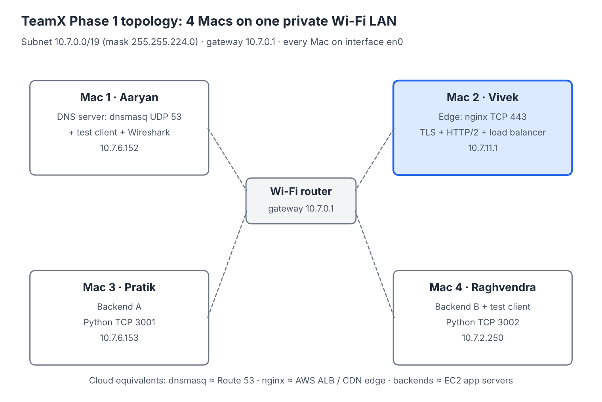

**Phase 2 topology** (green = added in Phase 2, dashed = failover path)

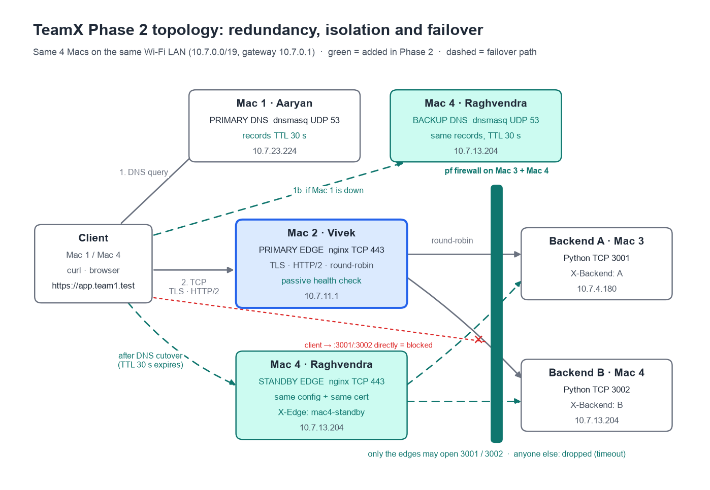

### Request flow

```
1. DNS      Client --UDP 53--> Mac 1 dnsmasq (or backup on Mac 4)   "app.team1.test?" -> 10.7.11.1, TTL 30
2. TCP      Client --SYN / SYN-ACK / ACK--> Mac 2 :443
3. TLS      ClientHello -> ServerHello -> Certificate -> Key exchange -> Finished   (ALPN picks h2)
4. HTTP/2   Encrypted GET /api/status -> nginx (TLS terminated here)
5. Proxy    nginx --plain HTTP, round-robin--> Mac 3 :3001 (Backend A) or Mac 4 :3002 (Backend B)
6. Reply    JSON + X-Backend header travels back the same way
```

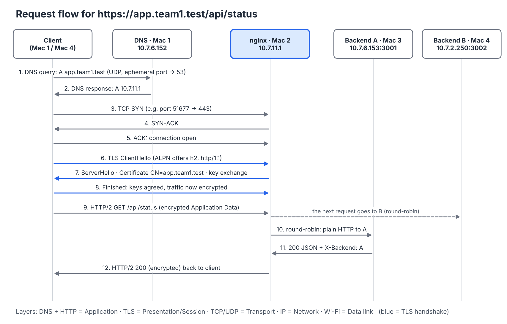

| OSI layer | In this project |
|---|---|
| 7 Application | DNS, HTTP/1.1, HTTP/2, REST API |
| 6/5 Presentation/Session | TLS 1.2 / 1.3 |
| 4 Transport | TCP (443, 3001, 3002), UDP (53), client ephemeral ports |
| 3 Network | IPv4 10.7.x.x |
| 2/1 Data link/Physical | Wi-Fi 802.11, MAC addresses |

## Repository layout

```
backend/backend.py        Backend A and B (same code, different arguments; Python standard library only)
configs/                  Phase 1: dnsmasq.conf (Mac 1), team1.conf (nginx, Mac 2), TLS-setup.md
configs/phase2/           Phase 2: primary/backup dnsmasq, primary/standby nginx, pf firewall rules
scripts/                  Phase 2 tools; every IP lives in scripts/team.env
docs/                     Diagrams, Phase 2 report (PDF + Markdown), runbook, troubleshooting playbook
evidence/                 Screenshots for every task, extension and failure demo
```

The TLS private key (`app.key`) is intentionally **not** in this repository.

## How to run

### Backends (Mac 3, Mac 4)
```bash
python3 backend/backend.py A 3001        # Mac 3
python3 backend/backend.py B 3002        # Mac 4
```
They listen on `0.0.0.0` so other machines on the LAN can reach them.

| Endpoint | Response |
|---|---|
| `GET /` | JSON confirming the service is running |
| `GET /api/status` | `{"backend": "A", "status": "ok", ...}`, `Cache-Control: no-store` |
| `GET /api/config` | Caching demo: `Cache-Control: public, max-age=60` + `ETag`; **304** for a matching `If-None-Match` |
| every response | `X-Backend: A` or `X-Backend: B` |

### DNS (Mac 1 primary, Mac 4 backup)
```bash
brew install dnsmasq
sudo cp configs/phase2/dnsmasq-primary.conf $(brew --prefix)/etc/dnsmasq.conf   # backup: dnsmasq-backup.conf
sudo brew services restart dnsmasq
scripts/set_client_dns.sh both            # on clients: primary + backup DNS
```

### Edge (Mac 2 primary, Mac 4 standby)
```bash
brew install nginx
# certificate: configs/TLS-setup.md (the standby uses the same app.crt + app.key)
cp configs/phase2/team1.conf $(brew --prefix)/etc/nginx/servers/team1.conf       # standby: team1-standby.conf
sudo nginx -t && sudo brew services restart nginx
```

### Check it (from a client, by name, never with `-k`)
```bash
scripts/preflight.sh                      # this Mac's IP, MAC, gateway, pings to the others, local services
dig app.team1.test                        # -> 10.7.11.1, TTL 30
curl -v https://app.team1.test/api/status # TLS 1.3, certificate verify ok, HTTP/2
scripts/lb_test.sh                        # A/B alternating, which edge answered, which backends were tried
scripts/diagnose.sh                       # DNS -> IP -> TCP -> TLS -> HTTP -> backend, stops at the first failure
```
If DHCP changes a Mac's address: `scripts/retarget_ip.sh <old-ip> <new-ip>` updates `team.env` and every Phase 2 config.
Step-by-step commands for every extension are in the [runbook](docs/PHASE2_RUNBOOK.md).

## Phase 1 results

| Test | Result |
|---|---|
| Ping between all Macs | 0% packet loss |
| DNS from Mac 3 and Mac 4 (no `@server`) | `app.team1.test → 10.7.11.1`, answered by Mac 1 |
| HTTPS by name | `TLSv1.3`, `SSL certificate verify ok`, no `-k`, padlock in the browser |
| Protocol | ALPN `h2` → `HTTP/2 200`; `--http1.1` → `HTTP/1.1 200 OK` |
| Load balancing | `X-Backend: A, B, A, B, A, B` |
| Caching | `cache-control: public, max-age=60`, `etag`; conditional request → `HTTP/2 304`, `content-length: 0` |
| Wireshark | DNS query/response on UDP 53; SYN/SYN-ACK/ACK to 443; ClientHello/ServerHello/Certificate; encrypted Application Data |

| # | Failure | Observation | What it proves |
|---|---|---|---|
| 1 | Wrong DNS server on the client | `NXDOMAIN` / "Could not resolve host", but `ping 10.7.11.1` works | DNS and IP connectivity are independent |
| 2 | DNS record → wrong IP | dig answers the wrong IP, curl times out | DNS is a directory, not a connection |
| 3 | Backend A stopped | every response `X-Backend: B` | nginx routes around a failed backend |
| 4 | Both backends stopped | `HTTP/2 502` from nginx | DNS + TLS work; the fault is behind the edge |
| 5 | Wrong port (`:9999`) | "Connection refused", ping still works | IP selects the host, port selects the service |

## Phase 2 results

| Extension | What we built | Result on the LAN |
|---|---|---|
| **A** Backup DNS | second dnsmasq on Mac 4 with identical records; clients list both servers | Mac 1's DNS stopped: 3× `connection refused` from Mac 1, then the answer from `SERVER: 10.7.13.204#53` in 24 ms; the site stayed up by name |
| **B** TTL + record change | `local-ttl=30` (Phase 1 was 0 = never cached); change a record live | the server answered the new IP at once; the client's cache kept the old one for **13 s** (within the 30 s TTL); a cache flush took effect immediately |
| **C** Service isolation | pf anchor `com.apple/team1` on Mac 3 + Mac 4: only the edge may open 3001/3002 | client → backend ports `Operation timed out` while ping still worked; service unaffected through the edge; rollback restored the original state, `/etc/pf.conf` never edited |
| **D** HA failover | passive health checks (`max_fails=3`, `fail_timeout=10s`), retry on the other backend | Backend A stopped: 40+ requests, all `200` from B, 0 client errors; `X-Upstream: …3001, …3002 (502, 200)` shows the same-request failover; A rejoined after restart |
| **E** Edge migration | standby nginx on Mac 4 (same config, same certificate) + DNS cutover | switched to `X-Edge: mac4-standby` **13 s** after the record change, no TLS warning, still load-balanced |
| **F** Troubleshooting | `scripts/diagnose.sh` + [playbook](docs/TROUBLESHOOTING.md) | names the first failing layer; tested against DNS, TCP, TLS and backend faults |

**Remaining single point of failure:** the active edge (nginx on Mac 2) and the single Wi-Fi LAN. The standby edge is reached only through a manual DNS change, which takes up to one TTL. Removing the SPOF properly needs a floating virtual IP (VRRP/keepalived) or health-checked DNS failover, which managed cloud load balancers provide.

Details, findings and the learning summary are in the [Phase 2 Final Report](docs/PHASE2_REPORT.pdf).

## Evidence

All screenshots are in [`evidence/`](evidence/) (index: [evidence/README.md](evidence/README.md)).

**Load balancing** (terminal output from Mac 1):
```
$ for i in 1 2 3 4 5 6; do curl -s -D - https://app.team1.test/api/status -o /dev/null | grep -i x-backend; done
x-backend: A
x-backend: B
x-backend: A
x-backend: B
x-backend: A
x-backend: B
```

**HTTPS by name, TLS 1.3, HTTP/2, no `-k`**

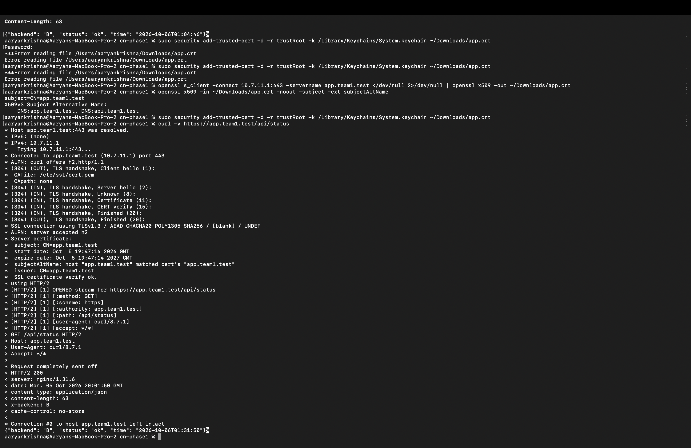

**Full TCP + TLS exchange in Wireshark** (SYN → SYN-ACK → ACK → Client Hello → Server Hello/Certificate → encrypted Application Data → FIN)

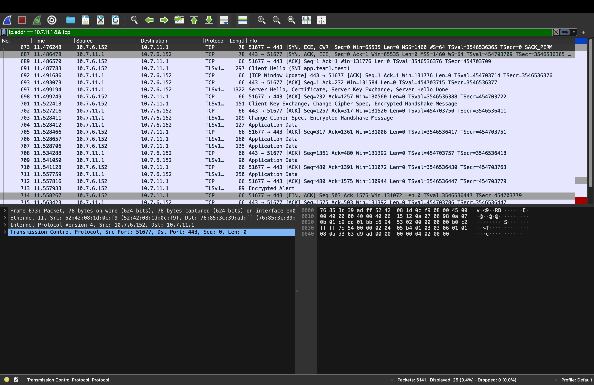

**DNS query and response (UDP 53)**

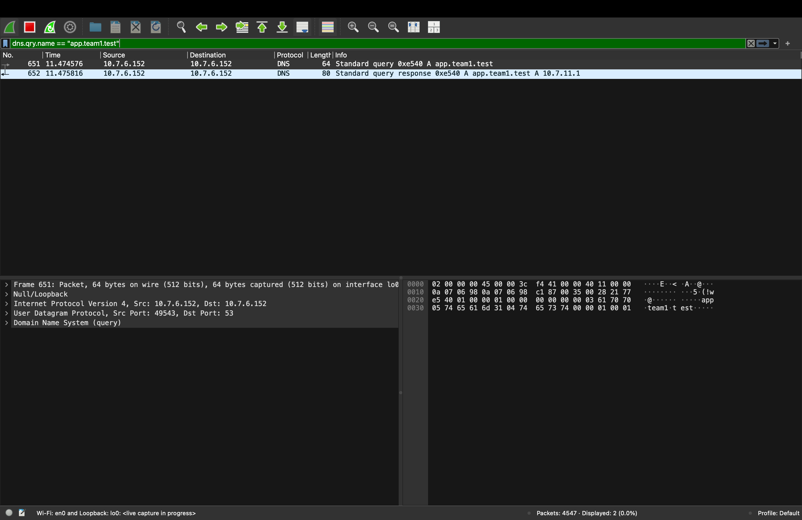

**Caching: conditional request returns 304**

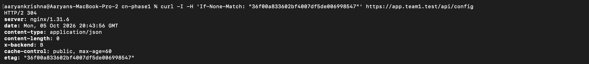

**Both backends down → 502 from the edge**

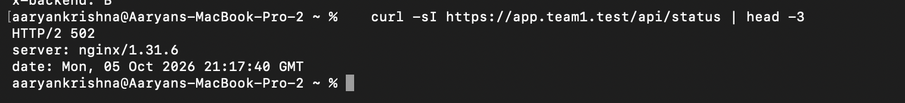

**Phase 2: primary DNS down, the backup on Mac 4 answers**

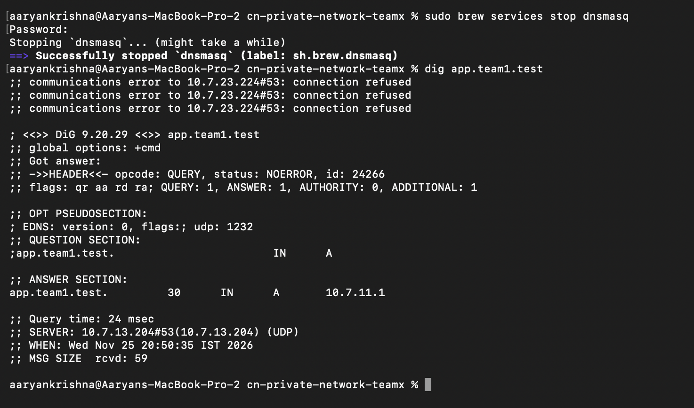

**Phase 2: Backend A stopped, every request still served by B**

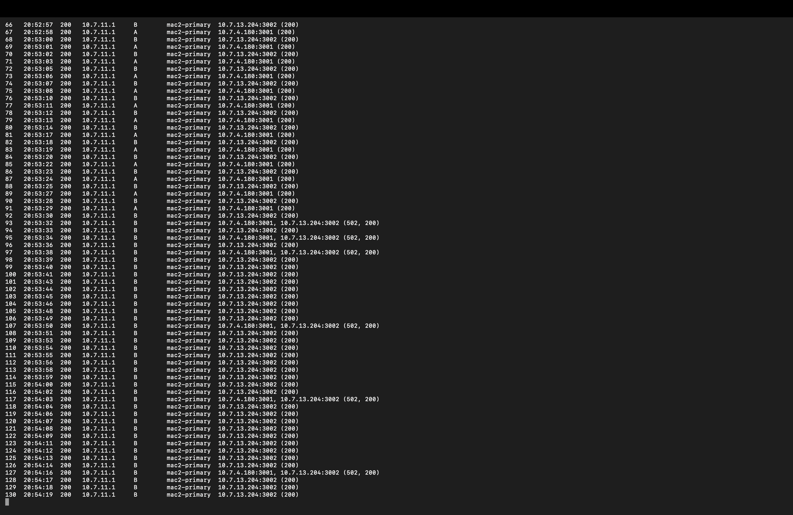

**Phase 2: backend ports blocked for clients, host still reachable**

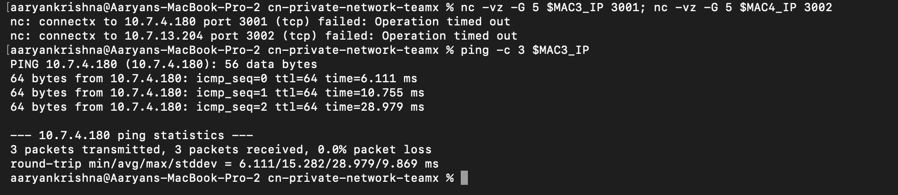

## Problems we hit and how we diagnosed them

- **Backend unreachable from one Mac only.** nginx timed out to Backend A while Mac 1 could reach it. We checked layer by layer: `ping` (IP OK) → `curl` direct to 3001 (TCP) → nginx `error.log`.
- **Flaky college Wi-Fi.** Pings reached ~900 ms, and Wi-Fi power saving caused connect timeouts. We raised `max_fails` to 3 and `proxy_connect_timeout` to 10 s, and kept the laptops awake with `caffeinate`.
- **504 vs 502.** 504 = nginx waited and no backend answered; 502 = connections refused.
- **DHCP changed IPs between sessions.** Mac 1, Mac 3 and Mac 4 came back with new addresses, and Phase 1's hard-coded `listen-address` would have stopped dnsmasq. Phase 2 listens on all interfaces, and all IPs live in `scripts/team.env`.
- **Managed (college) Mac.** The backup DNS was planned on Mac 3, but its Application Firewall is locked and blocked incoming DNS (refused before dnsmasq started, timed out afterwards). We moved the backup DNS to Mac 4. pf (Extension C) still worked on Mac 3.
- **Stale DNS setting cut a Mac off.** Mac 3 still pointed at Mac 1's old IP, so `brew install` failed with "Could not resolve host": Failure 1 for real. We copied Mac 1's dnsmasq binary over the LAN instead.
- **`dig` vs the OS cache.** `dig` asks the server directly; curl and browsers use the macOS cache, which holds answers for the TTL. `scripts/dns_watch.sh` shows both side by side.
