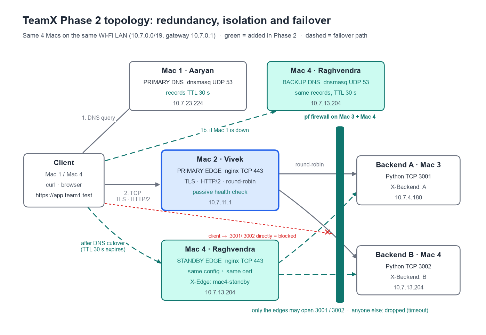

# Phase 2 Final Report: Harden, Recover, Troubleshoot

**Team:** TeamX (`team1.test`) · Aaryan Krishna (2401010010) · Vivek Kumar Raj (2401020077) · Pratik Agade (2401010346) · Raghvendra Singh (2401010367)
**Course:** Computer Networks, Private Network Service Platform

Phase 2 extends the Phase 1 network (4 Macs, private DNS, nginx edge with TLS, two backends) without rebuilding it. The four Macs, the domain, the certificate and the backend code are unchanged. We added redundancy (backup DNS, standby edge), control over caching (TTL), isolation (firewall) and the ability to diagnose faults.

## 1. What changed from Phase 1

| Area | Phase 1 | Phase 2 | Why |
|---|---|---|---|
| DNS servers | Mac 1 only | Mac 1 primary + **Mac 4 backup** with identical records; clients list both (planned on Mac 3, moved: see §3) | DNS is no longer a single point of failure (Ext A) |
| DNS TTL | dnsmasq default **0** (answers never cached) | `local-ttl=30` + `host-record=…,30` | Visible, controllable caching and cutover time (Ext B) |
| dnsmasq binding | `listen-address=127.0.0.1,10.7.6.152` | no `listen-address` (all interfaces) | DHCP changed Mac 1's IP to 10.7.23.224, and a hard-coded address would stop dnsmasq from starting |
| Edge | nginx on Mac 2 only | + **standby nginx on Mac 4**, same config and same certificate | Lets us move the edge by changing DNS (Ext E) |
| Failure detection | `max_fails=3 fail_timeout=5s`, `proxy_next_upstream error timeout` | `fail_timeout=10s`, retry also on `502/503/504`, `proxy_next_upstream_tries 2` | Passive health checking and same-request failover (Ext D) |
| Observability | `X-Backend` | + `X-Edge`, `X-Upstream`, `X-Upstream-Status`, `/edge-health` | Shows which edge answered, which backends were tried and whether nginx itself is healthy |
| Backend access | any LAN host could reach :3001/:3002 | **pf** allows only the edge(s); others are dropped | Service isolation: the edge is the only way in (Ext C) |
| Tooling | manual commands | `scripts/`: `diagnose.sh`, `lb_test.sh`, `dns_watch.sh`, `dns_set_record.sh`, `pf_enable/disable.sh`, `preflight.sh`, `retarget_ip.sh` | Repeatable demos and systematic diagnosis (Ext F) |

Configuration bundle: `configs/phase2/` (`dnsmasq-primary.conf`, `dnsmasq-backup.conf`, `team1.conf`, `team1-standby.conf`, `pf-backends.conf`). The Phase 1 configs remain in `configs/`.

## 2. Resilience tests and results

**Test-harness results.** Before the LAN run, we tested the Phase 2 nginx config (nginx 1.31 in Docker) against this repository's `backend.py` on 25 Nov:

| Test | Result |
|---|---|
| `nginx -t` on `team1.conf` | syntax ok |
| Both backends up | A, B, A, B, A, B; `X-Upstream` = one backend, status 200 |
| Backend A stopped | 6/6 requests 200 from **B**; `X-Upstream: …:3001, …:3002 (502, 200)` = A failed, nginx retried on B within the same request |
| Backend A restarted | alternation A/B resumed after `fail_timeout` |
| Both stopped | `502` from nginx, `X-Upstream-Status: 502, 502`; `/edge-health` still 200 |
| dnsmasq config | `dnsmasq --test` OK; answers `app.team1.test. 30 IN A 10.7.11.1` (TTL 30) |
| `diagnose.sh` with injected faults | name not resolvable → **DNS**; nginx stopped → **TCP (refused)**; untrusted cert → **TLS**; backends stopped → **backend**; healthy → ALL LAYERS OK |

**LAN results** (4 Macs, recorded during the Phase 2 review; evidence file names in `evidence/`):

| Ext | Test | Expected | Observed | Evidence |
|---|---|---|---|---|
| A | Clients list both DNS servers | `10.7.23.224`, `10.7.13.204` | `scutil --dns`: nameserver[0] `10.7.23.224`, nameserver[1] `10.7.13.204`, both reachable | `EXTA_1_client_two_dns.png` |
| A | Stop dnsmasq on Mac 1, `dig` from a client | answer from the backup `SERVER: 10.7.13.204#53` | 3× `communications error to 10.7.23.224#53: connection refused`, then `app.team1.test. 30 IN A 10.7.11.1` from `SERVER: 10.7.13.204#53` in 24 ms | `EXTA_4_failover_dig.png` |
| A | `curl https://app.team1.test` with the primary down | 200 by name | after flushing the cache, 4/4 requests `200` by name at 20:51 via `mac2-primary`, A/B alternating | `EXTA_5_service_still_works.png` |
| B | TTL visible | `30 IN A` | `app.team1.test. 30 IN A 10.7.11.1` (Phase 1: TTL 0) | `EXTB_1_ttl30.png` |
| B | Record changed, OS cache keeps the old answer | old IP until TTL expiry | record changed at 21:05:45 (server answered `10.7.13.204` at once); the client kept the cached `10.7.11.1` / `mac2-primary` until 21:05:56 and switched at **21:05:58, 13 s after the change** (within the 30 s TTL) | `EXTB_2/3_*.png` |
| B | Flush cache | new answer immediately | record set back at 21:08:20; `flush_dns.sh` at 21:09:12, the very next requests (21:09:13) went to `10.7.11.1` / `mac2-primary` | `EXTB_4_flush_immediate.png` |
| C | Mac 1 → 3001/3002 with pf on | `Operation timed out` | before: `Connection to 10.7.4.180 port 3001 succeeded`; with pf: `10.7.4.180:3001` and `10.7.13.204:3002` both `Operation timed out`, while `ping 10.7.4.180` = 0% loss | `EXTC_3_client_blocked.png` |
| C | Edge (Mac 2) still reaches the backends with pf on | service still 200 | `lb_test.sh` at 21:19: 6/6 `200` through `mac2-primary`, A and B alternating, i.e. nginx on Mac 2 (the only `<edges>` entry) still connects to both | `EXTC_6_service_still_works.png` |
| C | Rollback | anchor empty, `/etc/pf.conf` unchanged | Mac 3 and Mac 4: `pf disabled`, status back to the pre-test `Disabled`, anchor empty, `/etc/pf.conf identical to the backup` | `EXTC_8_rollback_mac3/4.png` |
| D | Stop Backend A | all 200 from B, no client errors | from 20:53:32 every request 200 from B (40+ requests, 0 errors); about every 10–14 s one request shows `10.7.4.180:3001, 10.7.13.204:3002 (502, 200)`: nginx retrying A after `fail_timeout`, failing over to B in the same request | `EXTD_2_A_down_all_B.png` |
| D | Restart Backend A | A/B alternate within ~10 s | Backend A's log shows nginx (10.7.11.1) sending it `GET /api/status` again right after restart; client back to A/B alternation | `EXTD_4_A_back.png` |
| E | Cutover `app.team1.test` → Mac 4 | `X-Edge: mac4-standby` after ≤ 30 s | switched after **13 s**; from 21:05:58 every request 200 via `10.7.13.204` / `mac4-standby`, still load-balanced A/B, no TLS warning | `EXTB_2_cached_old_answer.png`, `EXTB_3_ttl_expired_switch.png` |
| E | Cached vs fresh answer | cached client on old edge while fresh lookups get the new edge | for 13 s the DNS servers already answered `10.7.13.204` while the cached client was still served by `mac2-primary`; on the way back, the flushed client was on `mac2-primary` immediately | `EXTB_3`, `EXTB_4` |
| F | Faculty-injected fault | layer identified, fixed | performed live during the evaluation (method: `scripts/diagnose.sh` + `docs/TROUBLESHOOTING.md`) | live |

## 3. Troubleshooting findings

- **DHCP changed IP addresses between sessions.** On 25 Nov, Mac 1 had `10.7.23.224` instead of `10.7.6.152`. With Phase 1's `listen-address=10.7.6.152`, dnsmasq cannot bind and does not start. Every client would then fail at the DNS layer while ping still worked. Fix: dnsmasq listens on all interfaces; all IPs live in one file (`scripts/team.env`); `scripts/retarget_ip.sh old new` updates every config; `scripts/preflight.sh` runs on each Mac before a demo.
- **dnsmasq's default local TTL is 0.** In Phase 1, every lookup went back to the server, so there was no caching to observe. Setting `local-ttl=30` made the TTL appear in `dig` and made clients cache.
- **`dig` does not show client caching.** `dig` talks straight to the DNS server and always shows the new record. Only `dscacheutil`/`curl`/the browser go through the macOS cache (mDNSResponder). `dns_watch.sh` prints both side by side for that reason. Browsers keep their own DNS cache too, so we use curl for the cutover demo.
- **Records must change on both DNS servers.** With a backup resolver, changing only Mac 1 gives inconsistent answers depending on which server a client asks. `diagnose.sh` warns when the two disagree.
- **Refused vs timed out is a diagnostic signal.** A closed port answers with a TCP RST (`Connection refused`, quick). A pf `block drop` sends nothing back (`Operation timed out`). nginx turns these into 502 (refused) and 504 (timeout) for the client.
- **Passive health checks have a cost.** Open-source nginx only learns that a backend is down when a real request fails. The client never sees the error because nginx retries on the other backend, but each failed attempt adds latency. A powered-off Mac costs up to `proxy_connect_timeout` (10 s) before failover. Active health checks (NGINX Plus `health_check`, or a cloud LB's health checks) probe in the background instead.
- **Managed (college) Mac blocked the backup DNS.** Planned on Mac 3, the backup dnsmasq answered locally (`dig @127.0.0.1` OK) but timed out from the LAN: the macOS Application Firewall blocked it, and on a managed Mac it cannot be changed (`Firewall settings cannot be modified from command line on managed Mac computers`). Before it started, port 53 answered *refused*; afterwards *timed out*, which is how we told "nothing listening" apart from "firewall dropping". We moved the backup DNS to Mac 4 (the brief only requires "not Mac 1"); changing one line in `scripts/team.env` was enough. pf (Ext C) still worked on Mac 3, because pf is separate from the Application Firewall.
- **A stale Phase 1 DNS setting cut a Mac off from the internet.** Mac 3 still pointed at Mac 1's old IP, so `brew install` failed with `Could not resolve host: ghcr.io`: Failure 1 from Phase 1 happening for real. Because Homebrew downloads were not reachable from that Mac, we copied Mac 1's dnsmasq binary (it links only `libSystem`) over the LAN and ran it with `--pid-file=/tmp/...`.
- **Faculty fault (Ext F):** diagnosed live during the evaluation, layer by layer, with `scripts/diagnose.sh` and `docs/TROUBLESHOOTING.md`.

## 4. Learning summary (one paragraph per extension)

**A: Backup DNS.** Name resolution is a service with its own availability, separate from the application. Running identical records on a second machine and listing both servers on the clients meant stopping dnsmasq on Mac 1 cost only a slower first lookup: `dig` reported `connection refused` from 10.7.23.224 and then got the answer from the backup 10.7.13.204 (Mac 4) in 24 ms. The two failure types look different. When DNS fails, the name never becomes an IP (`Could not resolve host`) even though `ping` to the edge works. When the application fails, resolution and TLS succeed and nginx returns 502. That is the Route 53 idea in miniature: several authoritative name servers serving the same zone.

**B: TTL and controlled record change.** The TTL is the server telling resolvers how long they may reuse an answer. With TTL 30, `dig` showed the new record the moment we changed it, but our client kept using the cached old IP for another 13 s, until its cached copy expired. Flushing the cache made the change visible immediately. In production, the TTL is lowered well before a migration so the cutover window is short, then raised again afterwards to cut query load. The old endpoint must keep running until the old TTL has passed.

**C: Service isolation.** pf rules on Mac 3 and Mac 4 allow TCP to 3001/3002 only from the edge. A client can still ping the backend Macs but cannot open the ports: the SYN is dropped, so the connection times out instead of being refused. Meanwhile the service keeps working through nginx. This is the security-group / private-subnet pattern from the cloud: only the load balancer is exposed, and backends are reachable only through it. Loading the rules into an anchor kept `/etc/pf.conf` untouched, which made rollback a single command.

**D: High-availability failover.** nginx detects a dead backend passively. A refused connection makes it retry on the other upstream within the same request (`proxy_next_upstream`), and after `max_fails` it removes the backend for `fail_timeout`. With Backend A stopped, every client request still returned 200 from B, and `X-Upstream` showed the failed attempt on A. When A came back, round-robin resumed by itself. The remaining single point of failure is the edge on Mac 2. Removing it needs a second active edge behind a floating virtual IP (VRRP/keepalived) or health-checked DNS failover, which is what managed cloud load balancers provide.

**E: Controlled edge migration.** A standby nginx on Mac 4 with the same configuration and the same certificate let us move the whole service by changing one A record. Because both edges present the same certificate, clients saw no TLS warning. For up to one TTL after the change (13 s in our run), clients with a cached answer were still served by `mac2-primary` while new or flushed lookups went to `mac4-standby`. DNS-based cutover is simple and works anywhere, but it is never instant, and how long it takes depends on the TTL and on resolver caches outside our control.

**F: Troubleshooting.** The fastest way to an unknown fault is to follow the request path in order: client DNS settings, DNS answer, IP reachability, TCP port, TLS certificate, HTTP status from the edge, then the backends. Each layer has one command that answers yes or no (`dig`, `ping`, `nc -vz`, `openssl s_client`/`curl -v`, `curl -I`), and the first "no" is the layer to fix. Signals such as refused vs timeout, or 502 vs 504, narrow it further.
